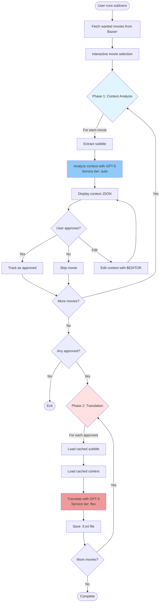
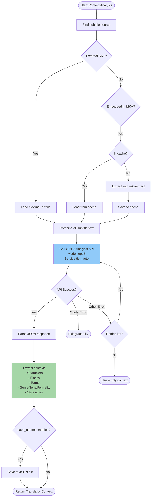
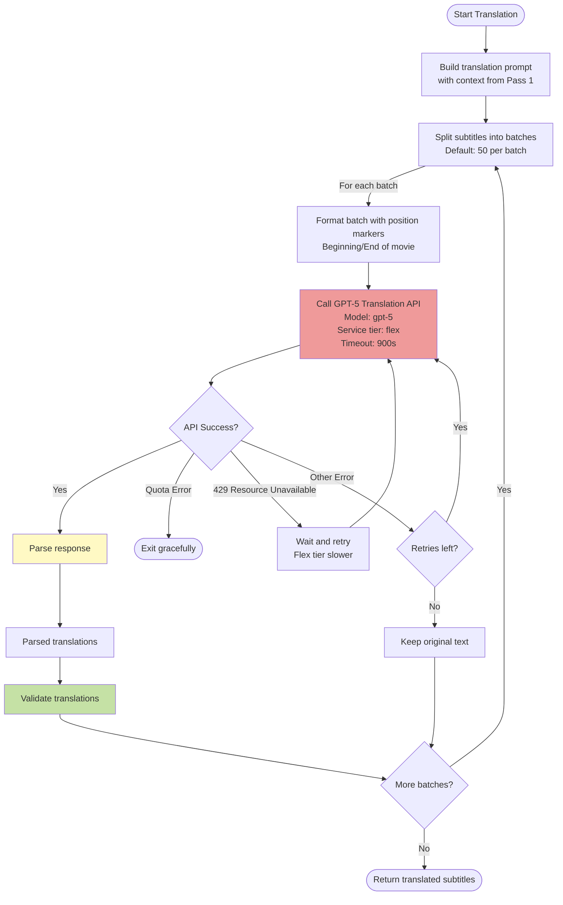
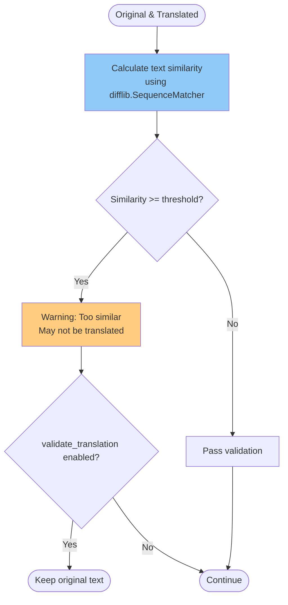
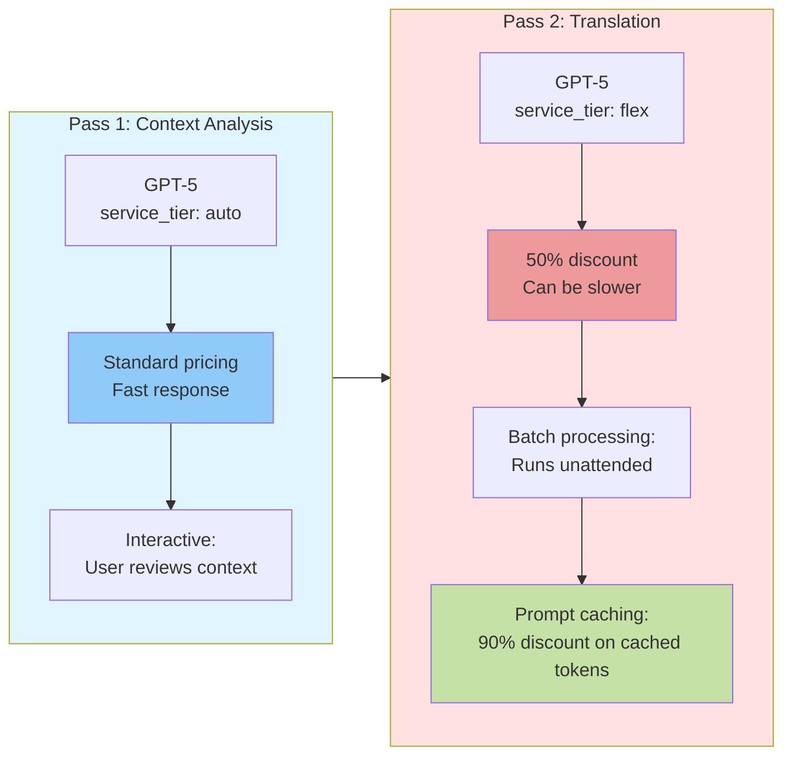

# Translation Process

This document describes the subtitle translation workflow in subtrans, including the two-pass architecture, parsing strategies, and quality validation.

## Overview: Two-Phase Workflow



## Pass 1: Context Analysis



## Pass 2: Batch Translation



## Translation Response Parsing (Liberal Parser)

```mermaid
flowchart TD
    Start([Raw API response]) --> Check{Response empty?}

    Check --> |Yes| Error1[Error: Empty response]
    Check --> |No| S1[Strategy 1: Split by \\n[NEXT]\\n]

    S1 --> Count1{Count = expected?}
    Count1 --> |Yes| Validate
    Count1 --> |No, got 1| S2[Strategy 2: Split by [NEXT]]

    S2 --> Count2{Count = expected?}
    Count2 --> |Yes| Validate
    Count2 --> |No, got 1| S3[Strategy 3: Split by \\n---\\n]

    S3 --> Count3{Count = expected?}
    Count3 --> |Yes| Validate
    Count3 --> |No, got 1| S4[Strategy 4: Fallback<br/>Split by \\n, filter separators]

    S4 --> Filter[Filter with _is_likely_separator:<br/>- No word characters?<br/>- Repeated chars ^^^.^^^?<br/>- Known markers?]
    Filter --> Count4{Count = expected?}

    Count4 --> |Yes| Validate
    Count4 --> |No| Error2[Error: Count mismatch]

    Validate[Content Validation] --> |For each| CheckContent{Valid content?}
    CheckContent --> |Has word chars| Valid[Valid translation]
    CheckContent --> |Separator-like| Error3[Error: Invalid content]

    Valid --> AllValid{All valid?}
    AllValid --> |Yes| Success([Return translations])
    AllValid --> |No| CheckContent

    Error1 --> Fail([Raise ValueError])
    Error2 --> Fail
    Error3 --> Fail

    style S4 fill:#fff9c4
    style Filter fill:#c5e1a5
    style Validate fill:#90caf9
```

## Separator Detection (Pattern-Based)

```mermaid
flowchart TD
    Start([Check if text is separator]) --> Strip[Strip whitespace]

    Strip --> Check1{Empty or [NEXT]?}
    Check1 --> |Yes| IsSep([True: Is separator])
    Check1 --> |No| Check2{Has word chars<br/>^^[\\w]^^?}

    Check2 --> |No| IsSep
    Check2 --> |Yes| Check3{Repeated pattern<br/>^^^.^^^\\1^^^2,^^^$^^?}

    Check3 --> |Yes, e.g. ---<br/>***<br/>===<br/>+++| IsSep
    Check3 --> |No| NotSep([False: Is content])

    style Check2 fill:#c5e1a5
    style Check3 fill:#fff9c4
```

## Quality Validation (Optional)



## Subtitle Source Priority

```mermaid
flowchart TD
    Start([Find English subtitle]) --> External{External SRT exists?}

    External --> |Yes| Patterns[Check patterns:<br/>*.en.srt<br/>*.EN.srt<br/>*.[Ee]ng*.srt<br/>*.[Ee]nglish*.srt]
    External --> |No| Embedded[Look for embedded MKV tracks]

    Patterns --> Found1{Found?}
    Found1 --> |Yes| Return1([Use external SRT])
    Found1 --> |No| Embedded

    Embedded --> MKVInfo[Run mkvmerge -J to get tracks]
    MKVInfo --> Filter[Filter:<br/>- Text subtitles only<br/>- Language: eng/en/english]

    Filter --> Found3{Found?}
    Found3 --> |Yes| ExtractTrack[Extract with mkvextract]
    Found3 --> |No| FirstText[Use first text track]

    FirstText --> Found4{Found?}
    Found4 --> |Yes| ExtractTrack
    Found4 --> |No| Error([Error: No subtitle found])

    ExtractTrack --> CacheCheck{In cache?}
    CacheCheck --> |Yes| Return2([Use cached])
    CacheCheck --> |No| Extract[Extract to cache]
    Extract --> Return2

    style Return1 fill:#a5d6a7
    style Return2 fill:#a5d6a7
```

## Cost Optimization: Hybrid Service Tiers



## Key Features

### Liberal Parsing ("Be liberal in what you accept")

- **Pattern-based separator detection** handles ANY separator format
- Only fails when translations are actually missing (count mismatch)
- Accepts: `---`, `***`, `===`, `+++`, `###`, custom patterns
- Strict validation: Each translation MUST contain word characters

### Cost Optimization

- **Pass 1 (auto tier)**: Fast, interactive context analysis with human review
- **Pass 2 (flex tier)**: 50% cost savings on unattended batch translation
- **Prompt caching**: 90% discount on cached tokens with flex tier

### Error Handling

- **Quota errors**: Exit gracefully, no partial writes
- **429 Resource Unavailable**: Automatic retry with longer timeout for flex tier
- **Parse failures**: Keep original text, continue processing
- **Network errors**: Retry with exponential backoff

### Quality Assurance

- **Context analysis**: Extract character names, places, terminology for consistency
- **Similarity check**: Warn if translation too similar to original (optional)
- **Content validation**: Ensure actual content, not separators
- **Count validation**: Verify correct number of translations received
